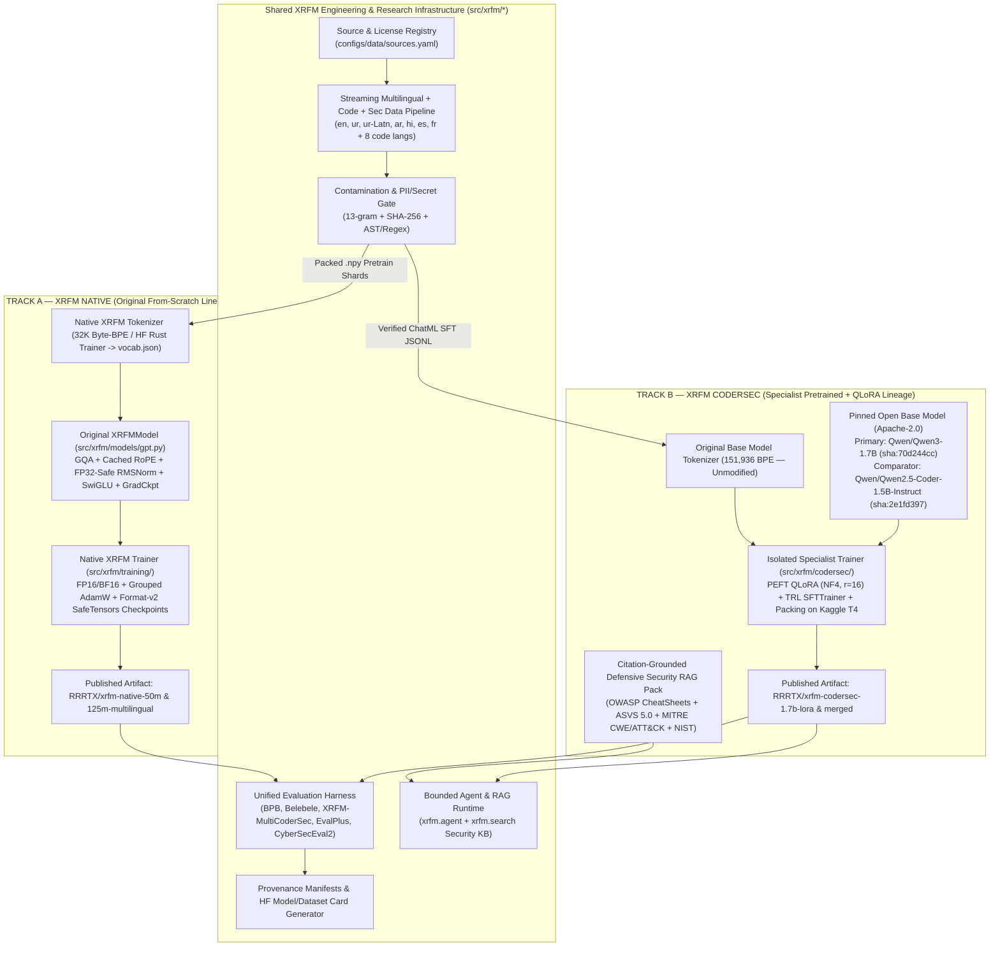
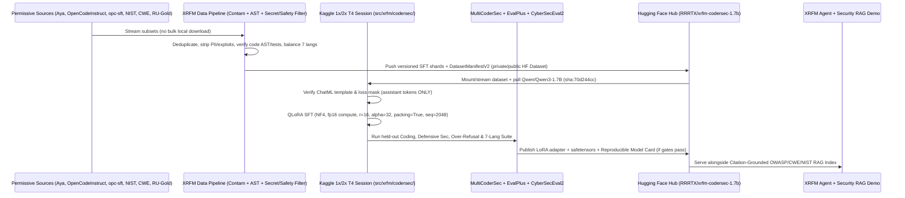

# XR Foundation Model (XRFM) — Target Dual-Track Architecture Specification

**Document Date:** 2026-11-17  
**Baseline Audited Commit:** `90674742d8e6a5caf65336e4b64c949696e33bc0`  
**Scope:** Coherent target architecture for **Track A (`XRFM Native`)**, **Track B (`XRFM CoderSec`)**, and **Shared Engineering Infrastructure**, strictly enforcing architectural lineage separation while maximizing shared data governance, evaluation, and runtime tooling.

---

## 1. Architectural Lineage & Strict Boundary Contract

XRFM operates as **one research program with two strictly separated model lineages** sharing common governance, data validation, evaluation, and bounded execution infrastructure:

### Non-Negotiable Lineage Rules
1. **Zero Cross-Loading of Weights:** Third-party pretrained weights (`Qwen3`, `Qwen2.5-Coder`, `Granite`, etc.) are **never** loaded into `xrfm.models.XRFMModel`, and `XRFM CoderSec` is **never** described in documentation, model cards, or UI banners as trained from scratch.
2. **Package Isolation (`src/xrfm/codersec/`):** Track B fine-tuning, PEFT/TRL configuration, ChatML formatting, and adapter merging live in an isolated optional subpackage `src/xrfm/codersec/` with optional dependency group `pip install -e ".[codersec]"` (`transformers`, `peft`, `trl`, `bitsandbytes`, `datasets`, `safetensors`), keeping `xrfm` core (`torch`, `pyyaml`, `numpy`, `jsonschema`) lightweight!
3. **Tokenizer Preservation on Track B:** Track B retains the base model's exact 151,936-token vocabulary and chat template (`<|im_start|>`, `<|im_end|>`, `<think>`) without embedding resizing, avoiding catastrophic forgetting of pretrained multilingual/coding representations.

---

## 2. Track A — XRFM Native Target Architecture

### 2.1 Component-by-Component Reuse / Refactor / Replace Matrix

| Subsystem | Current File(s) | Decision | Exact Architectural Evolution |
|---|---|---|---|
| **1. Tokenizer & Vocabulary** | `src/xrfm/tokenization/{interface.py, bpe.py, encode.py, decode.py}` | **PRESERVE ABC + REFACTOR `bpe.py` + ADD `hf_trainer.py` & `sentencepiece_adapter.py`** | • Keep `Tokenizer` ABC and special-token contract (`<|pad|>`, `<|bos|>`, `<|eos|>`, `<|unk|>`, plus optional `<|im_start|>`, `<|im_end|>`, `<|fim_prefix|>`, `<|fim_middle|>`, `<|fim_suffix|>` reserved cleanly). • Refactor `BytePairEncoder.train_on_text` to pre-aggregate word frequencies (`Counter`) + Unicode-aware pre-tokenization regex (`\p{L}\p{M}*` keeping Devanagari matras & Arabic harakat attached to base characters, 1–3 digit splitting, whitespace/indent preservation) + special-token literal splitting in `encode()`. • Add `HFByteBPETokenizer` (`tokenizers` Rust backend) + converter to XRFM `vocab.json` so 32K vocab training runs in `<60s` while pure-Python `BPETokenizer` can load and run inference with zero Rust runtime requirement! • Unify `TokenizerInfo.from_tokenizer` (`data/tokenization.py`) to use `tokenizer_fingerprint()` (`interface.py`) so vocab/merge changes always change the dataset hash. |
| **2. Model Configuration** | `src/xrfm/config/schema.py` | **EXTEND (Backward-Compatible Defaults)** | Add optional fields with 100% backward-compatible defaults to `ModelConfig`: • `n_kv_heads: int | None = None` (`None` $\implies$ `n_heads` standard MHA; `< n_heads` $\implies$ Grouped-Query Attention **GQA**). • `rope_theta: float = 10000.0` (allows `100000.0`–`500000.0` for `2048–4096` context). • `norm_eps: float = 1e-6`. • `gradient_checkpointing: bool = False` in `TrainingConfig`. • `min_lr_ratio: float = 0.1` in `TrainingConfig`. |
| **3. Transformer Core** | `src/xrfm/models/{gpt.py, embedding.py}`, `attention/{multi_head.py, rope.py}`, `layers/{rmsnorm.py, swiglu.py, transformer_block.py}` | **REFACTOR IN PLACE (Preserve XRFM Identity)** | • **Fix `RoPE` (`rope.py`):** Cache `cos_cached` and `sin_cached` buffers lazily up to `max_seq_len`, compute angles in `float32`, and cast output back to `x.dtype` (`(x.float() * cos + rotate_half(x.float()) * sin).to(x.dtype)`) so `fp16`/`bf16` Q & K never mismatch V in SDPA! • **Fix `RMSNorm` (`rmsnorm.py`):** Upcast variance calculation to `float32` (`x_fp32 = x.float(); norm = x_fp32 * torch.rsqrt(x_fp32.pow(2).mean(-1, keepdim=True) + self.eps); return self.weight * norm.to(x.dtype)`) — eliminates FP16 overflow on Kaggle P100/T4. • **Enable True FlashAttention/MemEfficient SDPA (`multi_head.py`):** When `mask is None` and `cache_len == 0` (standard packed pretraining!), pass `mask=None` so `flash_attention_forward` calls `F.scaled_dot_product_attention(..., attn_mask=None, is_causal=True)` — unlocking native FlashAttention-2 / Turing MemEfficient kernels with $O(L)$ memory! Only materialize additive mask when padding/custom `mask` or non-square `cache_len > 0` requires it. • **Add Optional GQA (`n_kv_heads`):** Support `W_k, W_v` projecting to `n_kv_heads * d_head` with `repeat_kv`, cutting KV-cache memory by 4×. • **Honor `use_swiglu=False`:** Wire `GELU` MLP fallback when `use_swiglu=False` so `ModelConfig` is 100% honest. • **Depth-Scaled Init & Remove Per-Step CUDA Sync:** Scale `W_o` and `W_3` init by `0.02 / sqrt(2 * n_layers)`, initialize embeddings with `normal_(0.0, 0.02)`, and gate `(input_ids >= vocab_size).any()` behind an optional debug flag rather than syncing CUDA every micro-step. |
| **4. Multilingual Streaming Data Pipeline** | `src/xrfm/data/*` | **REFACTOR TO STREAMING ITERATORS + UPGRADE LID** | • Add `StreamingParquetIngestor` / `HFStreamIngestor` (`src/xrfm/data/streaming.py`) yielding `Iterator[Document]` in bounded chunks (`batch_docs = 5,000`) instead of full-corpus `list[Document]`. • Upgrade `language.py`: Fix Urdu (`ur`) vs Arabic (`ar`) script disambiguation (detecting Urdu-specific characters `ٹ ڈ ڑ ں ہ ے گ چ پ ژ`), add Spanish (`es`) & French (`fr`) stopword/diacritic profiles, add dedicated **Roman Urdu (`ur-Latn`) + Code-Switch detector**, and wire optional `GlotLID` / `fastText` backend. • Add MinHash **LSH Banding** (`b=16, r=8` over 128 permutations) in `dedup.py` to turn $O(N^2)$ near-dedup into $O(N)$ streaming candidate lookup. • Fix `ShardedTokenDatasetMap` / `write_shards` to store `L + 1` tokens per sequence (or contiguous flat 1D memmap token arrays `shard.bin` + index) so zero boundary target tokens are wasted. • Fix `src/xrfm/data/cli.py:cmd_build` to parse **all** nested sections of `configs/data/pretrain.yaml`. |
| **5. Training, Validation & Checkpoints** | `src/xrfm/training/*` | **HARDEN FOR REAL CUDA & KAGGLE SESSIONS** | • Move `self.model.to(self.device)` *before* DDP/FSDP wrapping in `TrainingLoop.__init__`. • Group parameters in `OptimizerLoader`: `decay_params` (`p.dim() >= 2`, excluding `norm`) get `weight_decay`, while `no_decay_params` (`p.dim() < 2`, biases, `RMSNorm`) get `weight_decay = 0.0`. • Clamp cosine schedule `progress = min(1.0, ...)` with `min_lr = base_lr * min_lr_ratio`. • Add optional `torch.utils.checkpoint.checkpoint` in `TransformerBlock.forward` when `gradient_checkpointing=True`. • Add optional `safetensors` weight export alongside `.pt` format-v2 training state so final checkpoints publish cleanly to Hugging Face Hub. |
| **6. Evaluation & Inference** | `src/xrfm/evaluation/*`, `src/xrfm/inference/*` | **FIX CUDA BUGS + ADD BPB** | • Move batch inputs/targets to `model.device` in `compute_perplexity`, `TextCompletionAccuracy`, and `TopKAccuracy`. • Mask `batch_target_ids != ignore_index` in `TextCompletionAccuracy` and `TopKAccuracy`. • Add `compute_bits_per_byte(model, texts, tokenizer)` in `perplexity.py` for fair cross-tokenizer and per-language evaluation. |

### 2.2 Realistic, Compute-Matched XRFM Native Model Configurations (Kaggle Budget)

Never design a 1B+ native pretraining config for a 30 hr/week Kaggle T4/P100 budget. By Chinchilla scaling ($D \approx 20 N$), a 1B model needs ~20B tokens (~300+ GPU-hours on T4 = 10+ weeks of full quota). Instead, we define **three realistic, scientifically rigorous Track A tiers** achievable on Kaggle Free GPUs:

| Preset Name | `vocab_size` | `d_model` | `n_layers` | `n_heads` / `n_kv_heads` | `d_ff` (SwiGLU) | `max_seq_len` | Total Params (Tied Emb) | Compute-Optimal Tokens ($20N$) | Est. Time on Kaggle `2× T4` (FP16 DDP, `seq=1024`) | Research Purpose |
|---|---:|---:|---:|---|---:|---:|---:|---:|---|---|
| `xrfm-native-smoke` (`tiny.yaml`) | 2,048 | 64 | 2 | 4 / 4 | 256 | 128 | **0.26M** | 5M | `<2 min` (CPU/GPU) | CI regression & README quickstart |
| `xrfm-native-25m` (`config/native-25m.yaml`) | 32,768 | 384 | 8 | 6 / 2 (GQA) | 1,024 | 1,024 | **~24.8M** (`12.6M` emb + `12.2M` body) | **500M tokens** | **~3.5–4.5 hrs** (1 session!) | Rapid tokenizer & language-mix ablations (`BPB` across 7 langs) |
| `xrfm-native-85m` (`config/native-85m.yaml`) | 32,768 | 640 | 12 | 10 / 2 (GQA) | 1,792 | 2,048 | **~84.5M** (`21.0M` emb + `63.5M` body) | **1.7B tokens** | **~18–22 hrs** (2× 10h resumed sessions across 1 week quota) | Flagship reproducible multilingual + code Track A research checkpoint |

---

## 3. Track B — XRFM CoderSec Target Architecture

### 3.1 End-to-End Specialist Pipeline Architecture

### 3.2 Why Hybrid Parametric QLoRA + Citation-Grounded Security RAG Is Essential

A 1.5B–2B model should **not** rely solely on parametric weights to memorize 1,391 MITRE CWE IDs, 345 OWASP ASVS 5.0 controls, NIST SP 800-53 rev5 tables, or newly disclosed CVEs — doing so causes confident CWE/CVE number hallucinations! Conversely, RAG alone without fine-tuning fails on **multilingual/Roman-Urdu code-switching**, **structured secure-code diff review**, **calibrated defensive refusal vs. benign admin helpfulness**, and **consistent JSON/tool formatting**.

Therefore, **XRFM CoderSec** combines:
1. **Parametric QLoRA SFT (`Qwen/Qwen3-1.7B`):** Teaches *skills and behavior* — multi-language coding (`Python, JS/TS, C/C++, Rust, Bash, SQL`), vulnerability root-cause reasoning & patch synthesis, natural technical explanation across `en, ur, ur-Latn, ar, hi, es, fr`, tool-call schema discipline, and calibrated safety boundaries (refusing exploit weaponization while answering legitimate Linux/network defense tasks).
2. **Offline Citation-Grounded Security RAG (`src/xrfm/search/` upgraded + `SafeSecurityKBTool` in `src/xrfm/agent/`):** Indexes pinned releases of **OWASP Cheat Sheet Series**, **OWASP ASVS 5.0**, **MITRE CWE**, **MITRE ATT&CK Mitigations/Detections**, and **NIST SP 800-61r3 / SP 800-218** into a compact `<50 MB` local SQLite FTS5 / hybrid embedding index. Note this also **cleanly isolates `CC-BY-SA-4.0` OWASP text in an attributed retrieval pack** rather than entangling ShareAlike text inside Apache-2.0 model weights!

### 3.3 SFT Mixture Design for Track B (`~40,000` High-Quality Examples, `~28M` Tokens)

| Domain Pillar | Share | Target Examples | Primary Permissive Sources | Language Distribution |
|---|---:|---:|---|---|
| **1. Software Engineering, Code Gen, Debugging & Tests** | `35%` | `14,000` | `OpenCoder-LLM/opc-sft-stage2` (MIT) + execution-verified `nvidia/OpenCodeInstruct` (CC-BY-4.0) covering Python, JS/TS, C/C++, Rust, Bash, SQL | 65% `en`, 35% multilingual/code-switched prompts (`ur, ur-Latn, ar, hi, es, fr`) with standard English code identifiers |
| **2. Defensive Cybersecurity, Secure Code Review & Hardening** | `30%` | `12,000` | Grounded QA/remediation synthesized & verified from NIST SP 800-218/800-61r3 (Public Domain), MITRE CWE/ATT&CK mitigations, AST-verified `CyberNative/Code_Vulnerability_Security_DPO` (Apache-2.0), Linux/network hardening tasks | 60% `en`, 40% across `ur, ur-Latn, ar, hi, es, fr` |
| **3. Multilingual Technical Explanations & Roman-Urdu Code-Switching** | `25%` | `10,000` | `CohereLabs/aya_dataset` (`eng, urd, arb, hin, spa, fra`, Apache-2.0) + curated Stratum RU-1/RU-3 Roman-Urdu & Urdu/English programming/security dialogues | Balanced across `ur`, `ur-Latn`, `ar`, `hi`, `es`, `fr` |
| **4. Bounded Tool Use, RAG Citation & Calibrated Safety/Anti-Overrefusal** | `10%` | `4,000` | Security KB retrieval trajectories (citing CWE/NIST IDs), prompt-injection resistance examples, dual-use refusal examples + benign sysadmin/pentest-defense anti-overrefusal pairs | All 7 languages (`en, ur, ur-Latn, ar, hi, es, fr`) including `RUAB`-style code-switched prompts |

---

## 4. Shared Infrastructure & Anti-Bloat Design

Both tracks reuse the following single-implementation modules in `src/xrfm/` without adding heavy MLOps frameworks (no MLflow/Ray/Kubeflow servers):
1. **`configs/data/sources.yaml` + `src/xrfm/data/sources.py`:** Upgraded with `license_tier` (`tier_a`, `tier_b`, `hold`, `eval_only`), `script` (`Latn`, `Arab`, `Deva`), `pinned_revision` (commit SHA), and `allowed_tracks` (`["native", "codersec"]`). Pipeline refuses to build training shards from `eval_only` or `hold` sources!
2. **`src/xrfm/data/contamination.py`:** Pre-populated at build time with hashes and 13-grams of `HumanEval+`, `MBPP+`, `LiveCodeBench`, `MultiPL-E`, `CyberSecEval 2`, `Belebele`, and `XRFM-MultiCoderSec-Bench` so neither Track A nor Track B can accidentally train on evaluation tasks.
3. **`src/xrfm/experiment/tracking.py` + `src/xrfm/training/metrics.py`:** Lightweight append-only JSONL run logs + immutable JSON experiment manifests recording git commit SHA, base model SHA, dataset manifest SHA, seed, hardware (`nvidia-smi` query), peak VRAM (`torch.cuda.max_memory_allocated()`), wall time, loss curves, and benchmark scores.
4. **Unified Benchmark Runner (`src/xrfm/evaluation/`):** Adapter interface `EvalBackend` implemented by both `NativeXRFMEvalBackend` (wrapping `XRFMModel` + `BPETokenizer`) and `HFCausalLMEvalBackend` (wrapping `AutoModelForCausalLM` + optional `PeftModel` for Track B), guaranteeing identical metric computation, JSON reports, and confidence intervals across base models, LoRA checkpoints, and native baselines.
5. **Model & Dataset Card Generator (`src/xrfm/experiment/cards.py`):** Auto-renders Hugging Face `README.md` YAML frontmatter + provenance tables + per-language benchmark tables + explicit capability/safety disclaimers directly from verified JSON evaluation artifacts (eliminating unsupported manual README claims!).
